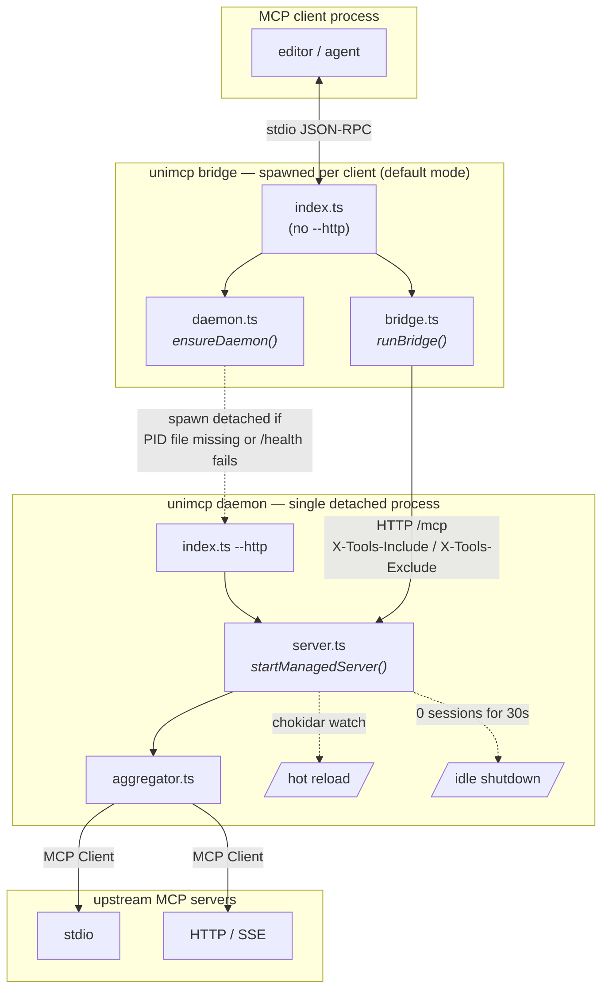

# AGENTS.md — unimcp

Coding agent reference for the **unimcp** repository: a TypeScript MCP aggregator that merges multiple upstream MCP servers into a single stdio/HTTP endpoint.

---

## Project layout

```
src/
  index.ts        # Commander CLI entry — routes to bridge, daemon, server, setup, collect, auth, mcp/status/stop
  config.ts       # Config types, JSONC loader, grants/profiles parsing, ${VAR} expansion (skips servers and profiles with unset vars), env-hash, pidFilePath, CONFIG_DIR, header constants
  aggregator.ts   # Upstream client manager — connect, merge tools, route calls, in-flight reconnect
  transport.ts    # Upstream transports (stdio / StreamableHTTP / SSE), transport and auth error checks, withTimeout
  server.ts       # Managed HTTP daemon — /health /status /mcp, sessions, idle shutdown, hot reload, port fallback
  daemon.ts       # Daemon spawn / supervisor — detached process, PID file, health-check loop
  bridge.ts       # Stdio ↔ HTTP bridge (default mode) — auto-reconnect, forwards UNIMCP_INCLUDE/EXCLUDE and held grants as headers
  grants.ts       # Held grants (env + watched file), the globs they leave locked, argument-rule locks, the file watcher
  profiles.ts     # Profile groups — expand profile grants into members ({var} fill), selector/pinned-arg schema rewrites, call routing
  substitute.ts   # `$(command)` substitution in env/headers/oauth.clientSecret, run as an upstream connects
  oauth.ts        # File-backed OAuthClientProvider (~/.config/unimcp/oauth/<name>.<urlHash>.json), AuthRequiredError
  auth.ts         # `auth <name>` command — browser OAuth flow with a localhost callback
  setup.ts        # `setup` command — register unimcp in client configs
  collect.ts      # `collect` command — read MCP configs from all clients, merge, output
  status.ts       # `status` command — list running daemons + loaded tools
  stop.ts         # `stop` / `restart` commands — kill by ID prefix, current context, or --all
  mcp.ts          # `list` / `get` / `add` / `add-json` / `remove` server CRUD
  mcp-format.ts   # CLI pretty-printer for server entries
  utils.ts        # Shared utilities (log, writeFileSafe, tryUnlink, identity constants, glob splitters)
bin/
  unimcp.js       # npm launcher: dynamic-imports dist/unimcp.js (the bundled output)
tests/
  *.test.ts       # Unit tests (bun test) — aggregator, config, grants, oauth, profiles, setup, substitute, utils
.github/
  workflows/
    ci.yml        # Type check + unit tests on push/PR to main
    codeql.yml    # CodeQL static analysis
    scorecard.yml # OSSF Scorecard
unimcp.json       # Server config (gitignored — user-created, not committed)
.env              # Secrets (gitignored)
tsconfig.json     # Strict ESNext, moduleResolution: Bundler, noEmit
package.json      # pnpm project, scripts below
```

### Architecture at a glance

Three process types. `index.ts` is the single binary entrypoint; CLI flags decide which role it plays.



- `index.ts` parses CLI and dispatches: default = `ensureDaemon → runBridge`; `--http` = `startManagedServer` (the daemon itself).
- `daemon.ts` runs **in the bridge process** as a client-side supervisor. It reads the PID file at `~/.config/unimcp/daemon.<envHash>.pid`, probes `/health`, and `spawn`s a detached `index.ts --http` process if nothing is alive.
- `server.ts` runs **in the daemon process** — owns the HTTP listener, session counter, hot reload, idle shutdown, and writes the PID file once it's bound to a port.
- `aggregator.ts` holds the upstream `Client` instances and merges their tools as `serverName__toolName`. It is owned by `server.ts` and swapped wholesale on config reload.
- `bridge.ts` connects to the daemon with `StreamableHTTPClientTransport`, retries with cooldown on transport errors, and re-invokes `ensureDaemon` if the daemon has died.

---

## Commands

```bash
# Development (no compile step — bun runs TS natively)
pnpm dev            # stdio mode: ensure daemon + bridge
pnpm http           # HTTP mode: managed server on :4848
pnpm daemon         # --daemon, an alias for --http
pnpm collect        # print merged config from all editors to stdout
pnpm register       # register unimcp in Claude Code, Copilot, OpenCode, Cursor

# Type checking and tests
pnpm typecheck      # tsc --noEmit — must pass before any commit
pnpm test           # bun test tests/ — run unit tests

# Build & install
pnpm bundle         # bun build --target=node → dist/unimcp.js (what the npm package runs)
pnpm build          # bun build --compile --minify → dist/unimcp
pnpm install-bin    # build + cp dist/unimcp /usr/local/bin/unimcp
```

No integration tests. Before committing: `pnpm typecheck` (zero errors) and `pnpm test` (all pass); smoke test: `printf '{"jsonrpc":"2.0","id":1,"method":"tools/list","params":{}}\n' | timeout 20 pnpm dev 2>/dev/null`

---

## TypeScript conventions

### Module system

- **ESM only** — `"type": "module"` in `package.json`
- All local imports use `.js` extension even for `.ts` source files:
  ```ts
  import { loadConfig } from './config.js'; // ✅
  import { loadConfig } from './config.ts'; // ❌
  import { loadConfig } from './config'; // ❌
  ```
- SDK imports use deep paths with `.js`:
  ```ts
  import { Client } from '@modelcontextprotocol/sdk/client/index.js';
  import type { Tool } from '@modelcontextprotocol/sdk/types.js';
  ```

### Import ordering

1. Node built-ins (`fs`, `http`, `child_process`, `path`)
2. Third-party packages (`chokidar`, `minimatch`, SDK)
3. Local files (`./config.js`, `./aggregator.js`)

Use `import type` for type-only imports.

### TypeScript strictness

- `strict: true` — no implicit any, strict null checks, etc.
- All function parameters and return types must be inferrable; explicit annotations where inference is insufficient
- Unused destructured variables prefixed with `_` (e.g., `{ upstreamName: _u, ...tool }`)
- Use `ReturnType<typeof X>` over manually duplicating types (e.g., `ReturnType<typeof setTimeout>`)

### Types and interfaces

- Use `type` aliases, not `interface`, for object shapes
- Export types with `export type`; never export bare `interface`
- Union types for discriminated variants: `type ServerConfig = StdioServer | HttpServer`
- Type guards via explicit functions: `function isHttpServer(s: ServerConfig): s is HttpServer`
- Options objects for functions with more than 2 parameters:
  ```ts
  // ✅
  export async function startManagedServer(
    opts: ManagedServerOptions,
  ): Promise<void>;
  // ❌
  export async function startManagedServer(
    port: number,
    host: string,
    configPath: string,
  );
  ```

---

## Code style

### File size

- Each file has a single clear responsibility
- Keep files under ~150 lines; extract helpers when approaching that limit

### Function design

- Functions do one thing; max ~50 lines
- Early return to reduce nesting — avoid deep if/else chains
- **Flow functions** only coordinate; zero domain logic
- **Worker functions** execute one task; never acquire a second responsibility
- Helper functions that are not part of a public API go below a `// --- helpers ---` comment at the bottom of the file

### Naming

- `camelCase` for variables, functions, parameters
- `PascalCase` for types and classes
- `SCREAMING_SNAKE_CASE` for module-level constants, with `_` separators in numbers: `const IDLE_TIMEOUT_MS = 30_000`
- Boolean variables: `is*`, `has*`, `use*` prefixes

### Async/await

- Always `await` Promises; never fire-and-forget unless intentionally detached (daemon spawn)
- Concurrent independent work: `await Promise.all([...])`, not sequential awaits
- `.catch()` only at the top-level entry point (`main().catch(...)`)

---

## Error handling

- On error: **either return it or log it — never both, never omit**. Breaks the flow → throw; flow continues → log and continue
- Upstream connection failures are non-fatal: logged, server skipped
- MCP protocol errors are wrapped in `McpError(ErrorCode.InternalError, String(err))`

---

## Logging

- **All logs go to `stderr`** via `log()` (`utils.ts`) — stdout is reserved for MCP JSON-RPC. Never `console.log`
- Prefix with `[moduleName]` or `[serverName]`: `[server]`, `[bridge]`, `[context7]`

---

## MCP SDK patterns

### Server (per-request, stateless HTTP mode)

```ts
const server = new Server({ name, version }, { capabilities: { tools: {} } });
// capabilities: { tools: {} } MUST be set at construction for tools to work
server.setRequestHandler(ListToolsRequestSchema, async () => ({ tools: [...] }));
server.setRequestHandler(CallToolRequestSchema, async (req) => { ... });
const transport = new StreamableHTTPServerTransport({ sessionIdGenerator: undefined });
await server.connect(transport);
await transport.handleRequest(req, res);
```

Upstream clients are built in `transport.ts` (`buildTransport`, `buildSSETransport`).

### Tool naming

- Aggregated tools are `serverName__toolName` (`SEP`); parse with `indexOf(SEP)` + `slice`, not `split` — tool names may contain `__`

---

## Key architectural rules

- `unimcp.json` is **gitignored** — never commit it; it is user-local
- `.env` is **gitignored** and not auto-loaded; secrets come from the shell environment. `${VAR}` is expanded from `process.env` at load (`loadConfig()`; `loadRawConfig()` leaves it intact); a server or profile referencing an unset or empty var is **skipped entirely**
- Config resolution: `--mcp-file` / `UNIMCP_CONFIG` > `./unimcp.json` > `DEFAULT_MCP_FILE` (`resolveMcpFile()` in `config.ts`). The file may contain comments (JSONC)
- Daemon pid file `~/.config/unimcp/daemon.<envHash>.pid` holds `"<pid>:<port>"`
  - `envHash` (`computeEnvHash()`): 8-hex SHA-256 over the config's absolute path, the unimcp version, and every referenced `${VAR}`'s value (unset → `""`). Any change → a separate daemon; clients with the same hash share one

### Key constants
```
DEFAULT_MCP_FILE = ~/.config/unimcp/unimcp.json          (config.ts)
CONFIG_DIR       = ~/.config/unimcp                     (config.ts)
PID_FILE         = ~/.config/unimcp/daemon.<envHash>.pid (pidFilePath() in config.ts)
OAUTH_DIR        = ~/.config/unimcp/oauth               (oauth.ts)
SYSTEM_BIN_PATH  = /usr/local/bin/unimcp                (setup.ts)
CLIENT_NAME      = "unimcp"                             (aggregator.ts; version is VERSION from package.json, utils.ts)
IDLE_TIMEOUT_MS  = 30_000                               (server.ts)
SPAWN_WAIT_MS    = 15_000                               (daemon.ts)
SEP              = "__"                                 (aggregator.ts)
PROFILE_ARG      = "profile"                            (profiles.ts)
```

- The daemon is a **shared background process** — `pnpm dev` bridges to it rather than spawning upstreams per client
- **Auto port fallback**: server tries `preferredPort` (default 4848); if `EADDRINUSE`, falls back to port 0 (OS-assigned); actual port written to pid file so bridge always discovers the right port
- `StreamableHTTPServerTransport` must be created **per request** (stateless: `sessionIdGenerator: undefined`)
- Upstream stdio servers inherit `{ ...process.env, ...srv.env }` — merge, not replace
- Reconnect on hot-reload: disconnect old aggregator before replacing with new one

### Per-client tool filtering

- The bridge forwards `UNIMCP_INCLUDE` / `UNIMCP_EXCLUDE` (comma-separated globs) as `X-Tools-Include` / `X-Tools-Exclude`; the daemon parses them into a `ToolFilter` for `aggregator.listTools(clientFilter?)`. A tool must pass both the server's `include`/`exclude` and the client filter; no filter = all tools. Direct HTTP callers set the headers themselves
- Grants (`grants.ts`): the config's top-level `grants` maps a grant to `server__tool` globs. The bridge sends the grants it holds (`UNIMCP_GRANTS` + `UNIMCP_GRANTS_FILE`) as `X-Tools-Grants`; the aggregator hides the globs of every grant not held — matched against the *prefixed* name, unlike include/exclude — so a request without the header holds nothing, and `tools/call` rejects a hidden tool. The bridge watches the grants file, reconnects with the new header on change, and sends `tools/list_changed`
- The daemon rejects `tools/call` for any tool its client filter hides (`aggregator.isCallable`, judged by name so a down server's tools still reach the reconnect)
- A grant rule may be `{ tool, args }` instead of a glob: it hides nothing, and `tools/call` is refused (`aggregator.lockingGrant`, naming the grant) when an unheld grant's rule matches the prefixed name and every one of its `args` equals the call's (pinned args included, so omitting a pinned value can't dodge a rule). A call no rule matches is open
- Profiles (`profiles.ts`): `parseGrants` turns a `{ server, vars, description? }` grant into `config.profiles[server][grant]`
  - A server with profiles becomes one upstream per profile, `<server>.<profile>` (also its OAuth store key), with `{var}`s in `command`/`args`/`env`/`url`/`headers`/`oauth` filled from the profile; a missing var skips the group. Server names containing `__` or colliding with a member name are skipped
  - Members are never listed or callable by their own name. The group lists the first connected member's tools once, with a required `profile` enum of the profiles the client holds (descriptions in the argument's description); a tool with its own `profile` argument is left out. `callTool` routes by it and strips it
  - `aggregator.lockingGrant` refuses a call naming an unheld profile, matched on the server prefix (a glob would let a `/` in a tool name slip past). A client holding none sees no group tools
  - `connect()` tries members in order until one succeeds; the rest stay `idle` and connect on first call
- `pinArgs` (any server): removed from the listed schemas and spread over the call's arguments last, so the client can't override them
- `$(command)` (`substitute.ts`) runs in `connectClient`, on every connect and reconnect, and in `auth`; only in `env`, `headers` and `oauth.clientSecret` (never `command`/`args`: argv is visible in `ps`). Errors name the command and exit code, never its output
- Grants are a guardrail, not a security boundary: the daemon trusts the claimed `X-Tools-Grants`. Grant globs are literal (`nonegate`, `nocomment`); empty lists/patterns are rejected at load
- A loopback-bound daemon answers only requests whose `Host` is a loopback name (DNS rebinding guard); the host comes from `--host`/`UNIMCP_HOST` only, never the generic `HOST`
### OAuth servers

- An HTTP/SSE server with `"auth": "oauth"` or an `oauth` block (`clientId`, `clientSecret`, `scopes`, `callbackPort`; default port 4849) gets a `FileOAuthProvider`. A `url` without `type` is HTTP.
- `unimcp auth <name>` runs the browser flow and writes tokens; the daemon is headless — without tokens it fails with `AuthRequiredError` (no retry loop) and connects when it sees the token file change (`retryIfDown`). Refresh is the SDK's, on 401.
- No `clientId` → dynamic client registration; servers without DCR (e.g. Slack) need `clientId`/`clientSecret`.

### Per-server fields

- `include` / `exclude`: globs on the unprefixed tool name, applied before aggregation
- `enabled: false`: skipped in `aggregator.connect()` without removing the config

---

## Collect command

`unimcp collect` merges MCP configs from installed editors into `{ "mcpServers": … }`: stdout, `-o <file>`, or `--save` (to the resolved config file, replacing only `mcpServers`). Sources, last-write-wins:
1. Claude Code user (`~/.claude.json` → `mcpServers`)
2. `.mcp.json` in cwd (`mcpServers`)
3. Cursor global (`~/.cursor/mcp.json` → `mcpServers`)
4. VS Code / Copilot global (`~/Library/.../Code/User/mcp.json` → `servers`, remapped)
5. OpenCode global (`~/.config/opencode/opencode.json` → `mcp`, remapped, enabled only)

---

## Setup / registration

`unimcp setup` (or `pnpm register`) registers the binary in editor configs:

**Local mode (default):** writes to `.mcp.json` (claude), `.cursor/mcp.json` (cursor), `.vscode/mcp.json` (copilot) in the current directory. Always creates/updates.

**Global mode (`--global`):** writes to user-level config files. Only updates if the config file already exists. Use `--target` to force-create.

| Target            | Local path (cwd)    | Global path                                      | Key          | Type value         |
| ----------------- | ------------------- | ------------------------------------------------ | ------------ | ------------------ |
| `claude`          | `.mcp.json`         | `~/.claude.json`                                 | `mcpServers` | _(implicit stdio)_ |
| `cursor`          | `.cursor/mcp.json`  | `~/.cursor/mcp.json`                             | `mcpServers` | _(implicit stdio)_ |
| `copilot`         | `.vscode/mcp.json`  | `~/Library/.../Code/User/mcp.json`               | `servers`    | `"stdio"`          |
| `opencode`        | _(none)_            | `~/.config/opencode/opencode.json`               | `mcp`        | `"local"`          |

- **Dedup**: skips a target if `"unimcp"` key already exists
- **`--global --target=claude,copilot`**: force-write global even if file doesn't exist
- OpenCode has no project-level equivalent (global only)

---

## npm package

- `@dandehoon/unimcp`, public. `bin/unimcp.js` dynamic-imports `dist/unimcp.js`, so that bundle must exist at publish time
- `engines.node` requires a patched Node (`^22.23.4 || ^24.22.1 || >=26.12.1`); CI pins Bun 1.4.4

### Release process (manual — no CI publish)

```bash
# 1. Bump version in package.json (semver)
# 2. Verify clean
pnpm typecheck && pnpm test

# 3. Commit, tag (signed), push
git commit -am "chore: release vX.Y.Z"
git tag -a vX.Y.Z -m "vX.Y.Z"
git push && git push --tags

# 4. Build bundle + publish (requires `npm login` with publish rights)
pnpm bundle                       # produces dist/unimcp.js
pnpm publish --no-git-checks
```

Recommended hardening: add `"prepublishOnly": "pnpm bundle"` so a forgotten bundle can't ship a broken `bin`.
