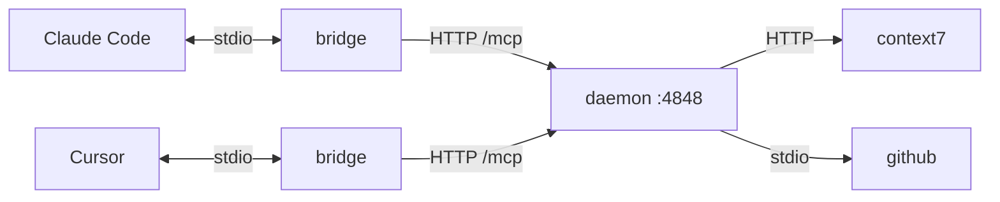

# unimcp

A local MCP aggregator. One config, one daemon, per-client tool control.

- **One config**: define every MCP server once in `unimcp.json`. Each client (Claude Code, Cursor, VS Code, OpenCode, …) connects through unimcp.
- **Auto daemon**: one shared background process owns all upstream connections. It starts on first use, exits after 30s idle, and hot-reloads on config change, so no orphaned Docker containers or stdio processes are left behind.
- **Client-side tool control**: each client picks the tools it sees with `UNIMCP_INCLUDE`/`UNIMCP_EXCLUDE`, with no server-side profiles.
- **Per-secret isolation**: different `${VAR}` values (e.g. two `GITHUB_TOKEN`s) get separate daemons.

## Quick start

```bash
npm install -g @dandehoon/unimcp     # or: npx @dandehoon/unimcp

# add servers (or import from your clients: unimcp collect --save)
unimcp add context7 --type http --url https://mcp.context7.com/mcp
unimcp add github --command npx --args "-y,@modelcontextprotocol/server-github" --env GITHUB_TOKEN='${GITHUB_TOKEN}'

# register unimcp with your clients
unimcp setup                    # all clients, current project
unimcp setup --global           # user-level config
unimcp setup --target=claude    # one client: claude, cursor, copilot, opencode
```

## Architecture

Each client spawns a thin stdio **bridge**; all bridges share one HTTP **daemon** that merges upstream tools as `serverName__toolName`.



- **Lifecycle**: the first bridge spawns the daemon; the daemon exits 30s after its last client leaves. If port 4848 (`UNIMCP_PORT`) is taken, it picks a free port. Bridges respawn a dead daemon.
- **Isolation**: a daemon serves one context: the config file, the unimcp version, and the values of the env vars the config references. Change any of these and a fresh daemon starts. Inspect them with `unimcp status`.

## Configuration

`unimcp.json` uses the standard `mcpServers` schema, so an existing Claude Code, Cursor, or Copilot config works as-is. Resolution order: `./unimcp.json` > `--mcp-file` / `UNIMCP_CONFIG` > `~/.config/unimcp/unimcp.json`.

`${VAR}` is expanded from the shell environment; a server referencing an unset variable is skipped.

```jsonc
{
  "mcpServers": {
    "context7": { "type": "http", "url": "https://mcp.context7.com/mcp" },
    "github": {
      "command": "npx",
      "args": ["-y", "@modelcontextprotocol/server-github"],
      "env": { "GITHUB_TOKEN": "${GITHUB_TOKEN}" },
      "include": ["search_*", "get_*"],   // per-server filter (also: exclude)
    },
    "experimental": { "command": "npx", "args": ["-y", "experimental-mcp"], "enabled": false },
  },
}
```

### Environment variables

| Variable | Purpose |
|----------|---------|
| `UNIMCP_CONFIG` | Config file path |
| `UNIMCP_PORT` | Daemon port (default: 4848) |
| `UNIMCP_HOST` | Daemon host (default: 127.0.0.1) |
| `UNIMCP_INCLUDE` | Comma-separated globs; only matching tools are visible |
| `UNIMCP_EXCLUDE` | Comma-separated globs; matching tools are hidden |
| `UNIMCP_GRANTS` | Comma-separated grants this client holds |
| `UNIMCP_GRANTS_FILE` | File of grants, one per line; changes apply mid-session |

### Per-client tool control

Set the filters in the client's unimcp entry. Globs match `serverName__toolName`, and a tool must pass both the server and the client filter.

```json
{ "mcpServers": { "unimcp": { "command": "unimcp", "env": { "UNIMCP_EXCLUDE": "internal__*" } } } }
```

### Grants

A top-level `grants` map hides the matching tools (globs on `serverName__toolName`) from every client that doesn't hold the grant:

```json
{
  "mcpServers": {},
  "grants": {
    "proddb": ["proddb__*"],
    "deploy-write": ["portal__create_*", "portal__update_*"]
  }
}
```

A client holds the grants in `UNIMCP_GRANTS` and `UNIMCP_GRANTS_FILE`. Locked tools are hidden and can't be called by name. When the grants file changes, the bridge updates the client's tool list without a restart.

Grants are a guardrail, not a security boundary: any local process can claim any grant. Leave tools that must never be reachable out of the config.

### OAuth servers

Add `"auth": "oauth"` to a remote server, then run `unimcp auth <name>` once to sign in through the browser. Tokens are stored owner-only under `~/.config/unimcp/oauth/` and refresh automatically; running daemons pick them up without a restart.

```jsonc
{
  "mcpServers": {
    // dynamic client registration: no client ID needed
    "jira": { "url": "https://mcp.atlassian.com/v1/mcp", "auth": "oauth" },
    // no dynamic registration: use a pre-registered client
    "slack": {
      "url": "https://mcp.slack.com/mcp",
      "oauth": { "clientId": "<id>", "clientSecret": "${SLACK_CLIENT_SECRET}", "scopes": ["chat:write"], "callbackPort": 3118 },
    },
  },
}
```

A pre-registered client must allow the redirect URL `http://localhost:<callbackPort>/callback` (default port 4849).

## Commands

```
unimcp                     Stdio bridge (starts the daemon if needed)
unimcp --http              Run the HTTP daemon directly
unimcp status              Running daemons and their tools
unimcp stop|restart [id]   Stop the current context's daemon, an ID prefix, or --all
unimcp auth <name>         Authorize an OAuth server
unimcp setup               Register unimcp in client configs
unimcp collect [--save]    Merge MCP configs from all clients
unimcp list | get <name>   Show configured servers
unimcp add <name> …        Add a server (--type, --command, --args, --env, --url, --header)
unimcp add-json <name> …   Add a server from JSON
unimcp remove <name>       Remove a server
```

## Development

```bash
pnpm install
pnpm dev          # stdio mode
pnpm typecheck
pnpm test
```

## License

MIT
