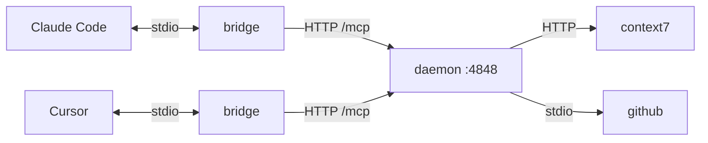

# unimcp

A local MCP aggregator. One config, one daemon, per-client tool control.

- **One config**: define every MCP server once in `unimcp.json`. Each client (Claude Code, Cursor, VS Code, OpenCode, …) connects through unimcp.
- **Auto daemon**: one shared background process owns all upstream connections. It starts on first use, exits after 30s idle, and hot-reloads on config change, so no orphaned Docker containers or stdio processes are left behind.
- **Client-side tool control**: each client picks the tools it sees with `UNIMCP_INCLUDE`/`UNIMCP_EXCLUDE`, and unlocks gated tools and server profiles with grants.
- **Per-secret isolation**: different `${VAR}` values (e.g. two `GITHUB_TOKEN`s) get separate daemons.

## Quick start

Requires Node `^22.23.4`, `^24.22.1` or `>=26.12.1`.

```bash
npm install -g @dandehoon/unimcp     # or: npx @dandehoon/unimcp

# add servers (or import from your clients: unimcp collect --save)
unimcp add context7 --type http --url https://mcp.context7.com/mcp
unimcp add github --command npx --args "-y,@modelcontextprotocol/server-github" --env GITHUB_TOKEN='${GITHUB_TOKEN}'

# register unimcp with your clients
unimcp setup                    # all clients, current project
unimcp setup --global           # user-level config
unimcp setup --target=claude    # one client: claude, cursor, copilot, opencode
```

## Architecture

Each client spawns a thin stdio **bridge**; all bridges share one HTTP **daemon** that merges upstream tools as `serverName__toolName`.



- **Lifecycle**: the first bridge spawns the daemon; the daemon exits 30s after its last client leaves. If port 4848 (`UNIMCP_PORT`) is taken, it picks a free port. Bridges respawn a dead daemon.
- **Isolation**: a daemon serves one context: the config file, the unimcp version, and the values of the env vars the config references. Change any of these and a fresh daemon starts. Inspect them with `unimcp status`.

## Configuration

`unimcp.json` uses the standard `mcpServers` schema, so an existing Claude Code, Cursor, or Copilot config works as-is. Resolution order: `--mcp-file` > `UNIMCP_CONFIG` > `./unimcp.json` > `~/.config/unimcp/unimcp.json`.

`${VAR}` is expanded from the shell environment; a server referencing an unset variable is skipped.

```jsonc
{
  "mcpServers": {
    "context7": { "type": "http", "url": "https://mcp.context7.com/mcp" },
    "github": {
      "command": "npx",
      "args": ["-y", "@modelcontextprotocol/server-github"],
      "env": { "GITHUB_TOKEN": "${GITHUB_TOKEN}" },
      "include": ["search_*", "get_*"]   // per-server filter (also: exclude)
    },
    "experimental": { "command": "npx", "args": ["-y", "experimental-mcp"], "enabled": false }
  }
}
```

### Command substitution

`$(command)` in `env`, `headers` or `oauth.clientSecret` is replaced with the command's trimmed output (run with `sh -c`) when that server connects, so a secret is read only when its server is used, and a rotated one is picked up on reconnect. It is never applied to `command` or `args`, where the value would be visible in `ps`.

```json
{ "headers": { "Authorization": "Bearer $(security find-generic-password -s my-token -w)" } }
```

### Pinned arguments

`pinArgs` fixes arguments on every call to a server: they are dropped from its tool schemas, and a client can't override them.

```json
{ "pinArgs": { "connectionId": "preconfigured" } }
```

### Environment variables

| Variable | Purpose |
|----------|---------|
| `UNIMCP_CONFIG` | Config file path |
| `UNIMCP_PORT` | Daemon port (default: 4848) |
| `UNIMCP_HOST` | Daemon host (default: 127.0.0.1) |
| `UNIMCP_INCLUDE` | Comma-separated globs; only matching tools are visible |
| `UNIMCP_EXCLUDE` | Comma-separated globs; matching tools are hidden |
| `UNIMCP_GRANTS` | Comma-separated grants this client holds |
| `UNIMCP_GRANTS_FILE` | File of grants, one per line; changes apply mid-session |

### Per-client tool control

Set the filters in the client's unimcp entry. Globs match `serverName__toolName`, and a tool must pass both the server and the client filter.

```json
{ "mcpServers": { "unimcp": { "command": "unimcp", "env": { "UNIMCP_EXCLUDE": "internal__*" } } } }
```

### Grants

A top-level `grants` map hides the matching tools (globs on `serverName__toolName`) from every client that doesn't hold the grant:

```json
{
  "mcpServers": {},
  "grants": {
    "proddb": ["proddb__*"],
    "deploy-write": ["portal__create_*", "portal__update_*"]
  }
}
```

A client holds the grants in `UNIMCP_GRANTS`, `UNIMCP_GRANTS_FILE`, and those `unimcp grant <pid>` holds for its process (the bridge's parent). That file is ignored if it predates the process, so a reused pid inherits nothing, and every edit removes the files of processes that have exited. Locked tools are hidden and can't be called by name. When a grants file changes, the bridge updates the client's tool list without a restart.

A rule can also lock calls by argument: `{ "tool": "<glob>", "args": { … } }` leaves the tool listed but refuses a call whose arguments equal every value in `args` (a server's `pinArgs` count as passed). A call no rule matches is open — including one that leaves the argument out, or names the same target another way — so to keep credentials apart, use profiles.

#### Profiles

A grant written as `{ "server", "vars" }` is a profile of that server: one copy of it (one per database, account, or workspace), granted on its own. The server's `{var}` placeholders in `command`, `args`, `env`, `url`, `headers` and `oauth` are filled from the profile's `vars`:

```jsonc
{
  "mcpServers": {
    "mongo": {
      "command": "npx",
      "args": ["-y", "mongodb-mcp-server", "--readOnly"],
      "env": { "MDB_MCP_CONNECTION_STRING": "{uri}" },
      "exclude": ["connect", "disconnect", "list-connections"],
      "pinArgs": { "connectionId": "preconfigured" }
    }
  },
  "grants": {
    "prod": { "server": "mongo", "vars": { "uri": "$(pass show mongo/prod)" }, "description": "orders and users, production" },
    "staging": { "server": "mongo", "vars": { "uri": "$(pass show mongo/staging)" } }
  }
}
```

Clients see `mongo__find` once, with a required `profile` argument listing the profiles they hold, each `description` included in the argument's own, so an agent knows what it picks; a client holding none sees no `mongo` tools, and a call naming a profile needs that grant. A server with no profile grants is listed as itself. `${VAR}` in `vars` is expanded like the rest of the config; a profile referencing an unset variable is skipped. At startup, profiles connect in order until one succeeds, to supply the tool schemas; the others connect on their first call. Authorize an OAuth profile with `unimcp auth <server>.<profile>`.

Grants are a guardrail, not a security boundary: any local process can claim any grant. Leave tools that must never be reachable out of the config.

### OAuth servers

Add `"auth": "oauth"` to a remote server, then run `unimcp auth <name>` once to sign in through the browser. Tokens are stored owner-only under `~/.config/unimcp/oauth/` and refresh automatically; running daemons pick them up without a restart.

```jsonc
{
  "mcpServers": {
    // dynamic client registration: no client ID needed
    "jira": { "url": "https://mcp.atlassian.com/v1/mcp", "auth": "oauth" },
    // no dynamic registration: use a pre-registered client
    "slack": {
      "url": "https://mcp.slack.com/mcp",
      "oauth": { "clientId": "<id>", "clientSecret": "${SLACK_CLIENT_SECRET}", "scopes": ["chat:write"], "callbackPort": 3118 }
    }
  }
}
```

A pre-registered client must allow the redirect URL `http://localhost:<callbackPort>/callback` (default port 4849).

## Commands

```
unimcp                     Stdio bridge (starts the daemon if needed); in a terminal, same as `status`
unimcp --http              Run the HTTP daemon directly
unimcp status              Running daemons and their tools
unimcp stop <id>           Stop the daemon whose ID starts with <id>
unimcp shutdown            Stop every running daemon
unimcp restart [id]        Stop the current context's daemon, an ID prefix, or --all; the next client respawns it
unimcp completion          Print the zsh completion script (`install-bin` installs it)
unimcp grant <pid> -- [±g…] Add (+g) or remove (-g) a client process's grants and print them; --drop clears
unimcp auth <name>         Authorize an OAuth server
unimcp setup               Register unimcp in client configs
unimcp collect [--save]    Merge MCP configs from all clients
unimcp list | get <name>   Show configured servers
unimcp add <name> …        Add a server (--type, --command, --args, --env, --url, --header)
unimcp add-json <name> …   Add a server from JSON
unimcp remove <name>       Remove a server
```

## Development

```bash
pnpm install
pnpm dev          # stdio mode
pnpm typecheck
pnpm test
```

## License

MIT
